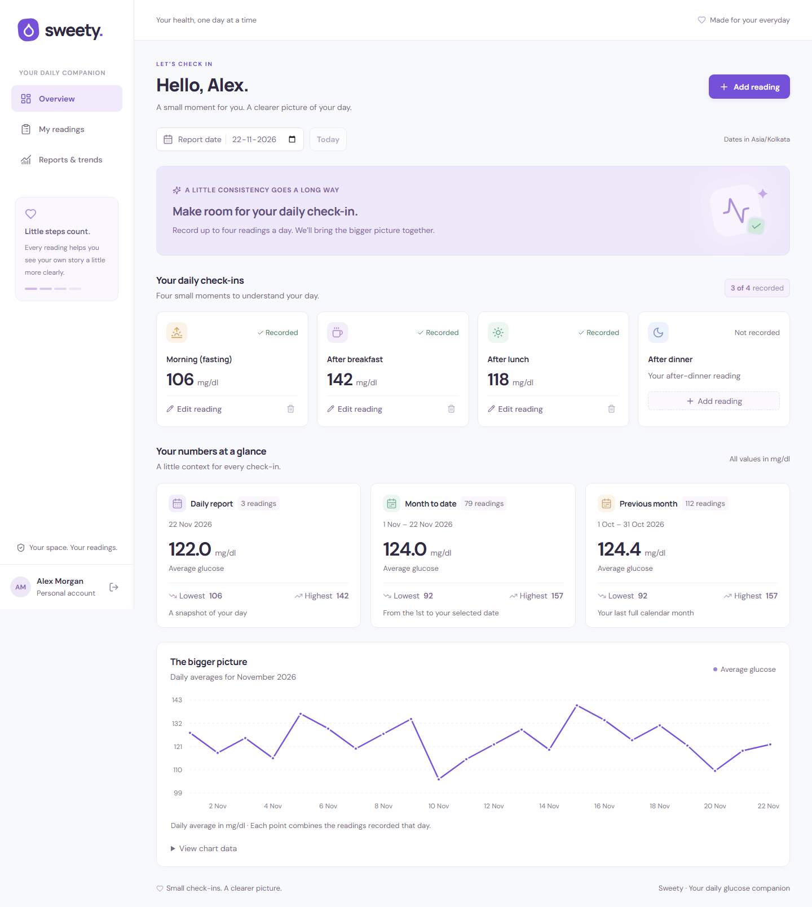

# Sweety — Blood Glucose Tracker

A small full-stack JavaScript app for recording up to four glucose readings a day and viewing daily and monthly reports. Built for the Kenpath Junior Full Stack Developer assignment with **React, Node.js, Express and PostgreSQL**.



## Features

- Register with a name, email and password; log in and log out.
- Passwords are hashed with bcrypt. Database-backed sessions use HttpOnly, SameSite cookies; raw session tokens are not stored in the database.
- Each patient sees and changes only their own readings and reports.
- Create, view, edit and delete readings, including corrections to the date and slot.
- Four slots: **Morning (fasting), After breakfast, After lunch, After dinner**.
- Clear form and API errors for a missing value, a non-integer or value outside **40–600 mg/dl**, a future date, an occupied slot or a fifth daily reading.
- Daily, month-to-date and previous-month reports with highest, lowest, average to one decimal and number of readings. Daily slot cards list every reading. Empty reports show a friendly message.
- Responsive dashboard, accessible form labels, keyboard-accessible dialogs, loading/error states and delete confirmation.

**All seven optional bonuses are included:** paginated reading history, a monthly line chart with an accessible data table, Docker Compose, React Testing Library form tests, Redis report caching, a BullMQ daily reminder worker, and a doctor workspace for assigned patients.

## Requirements

- Node.js **22.12 or newer** (Node 22 is used by Docker and CI).
- npm with workspace support; install dependencies once from the repository root.
- Docker Desktop / Docker Engine with Compose, or existing PostgreSQL **17** and Redis **7** servers.

## Quick start

Clone the repository and enter it:

```bash
git clone https://github.com/Misaa20/sweety-glucose-tracker.git
cd sweety-glucose-tracker
npm ci
```

Copy the environment example. In PowerShell:

```powershell
Copy-Item .env.example .env
```

On macOS/Linux:

```bash
cp .env.example .env
```

Start PostgreSQL and Redis, apply migrations and create the demo data:

```bash
docker compose up -d --wait db redis
npm run db:migrate
npm run db:seed
npm run dev
```

Open **http://localhost:5173**. Vite forwards `/api` to Express, keeping cookie authentication on the same origin.

| Demo login | Value               |
| ---------- | ------------------- |
| Email      | `demo@sweety.local` |
| Password   | `SweetyDemo123!`    |

These are public demo credentials, not production secrets. You can also create a new account to start with an empty journal.

The seed also creates **`doctor@sweety.local` / `SweetyDoctor123!`**, already assigned to the demo patient. Log in normally to open the doctor workspace: a patient selector, report date, all three summaries, daily slot readings and monthly chart. Doctor access is read-only. New registrations always create patients, ignoring any supplied `role`.

The seed creates readings from the start of the previous month through today, with three slots filled today. It preserves existing readings and resets only the demo account's name/password to the configured seed values. Re-running it does not duplicate readings.

It also refreshes the demo doctor's name/password and preserves the demo assignment. It will not promote an existing patient to doctor if the configured emails collide. A trusted operator with database access can assign another existing patient:

```bash
npm run doctor:assign -- doctor@sweety.local patient@example.com
```

There is no public doctor registration or self-assignment endpoint. Doctor provisioning uses the seed script; assignment management uses the operator script. Deleting an assignment from `doctor_patients` revokes access on the next request, including cached reports.

## Run server and client separately

Run these commands in two terminals, from the repository root:

```bash
# Terminal 1: API, default http://localhost:3001
npm run dev -w server

# Terminal 2: React, http://localhost:5173
npm run dev -w client
```

`npm run dev` starts both together. For the built app without the Vite dev server:

```bash
npm run build
npm start
```

Open **http://localhost:3001** and set `CLIENT_ORIGIN=http://localhost:3001` in `.env` before starting the built app. Express serves both the compiled frontend and `/api`.

## Redis caching and reminder worker

Redis defaults to `redis://localhost:6381/0`, avoiding an existing Redis on port 6379. Start it with `docker compose up -d --wait redis`.

Reports are cached for `REPORT_CACHE_TTL` seconds (default 300), scoped to patient, report date and database revision. Successful reading creates, edits and deletes clear all cached dates for that patient. A PostgreSQL trigger increments the revision in the reading transaction, preventing a concurrent, slow request from restoring stale results. Seed/direct SQL changes also update the revision; obsolete keys expire automatically. Authorized doctor and patient views share cached reports, with assignments checked before every lookup.

Report responses include `X-Report-Cache: MISS`, `HIT` or `BYPASS`. If Redis is unavailable or `REDIS_URL` is blank, core patient operations continue using PostgreSQL.

In a **third terminal**, start the worker:

```bash
npm run worker
```

BullMQ runs a daily check at **21:00 in `APP_TIMEZONE`**, configured by `REMINDER_CRON`. It inserts `reminder_logs` rows and writes structured console logs for patients with 0–3 readings that day. Doctors and patients with four readings are excluded. A unique patient/date constraint prevents duplicate logs across retries, restarts or manual runs. Reminders are logs only; no external messages are sent.

To demonstrate the job immediately while the worker is running, use another terminal:

```bash
npm run reminders:run
```

The command queues a real BullMQ job and waits up to 15 seconds for completion. An optional past date is supported: `npm run reminders:run -- 2026-10-15`. Repeating a check for the same day creates zero new logs. Each job persists its date on the first attempt, so a retry after midnight keeps the original date.

## Database setup

The default development database is available at `localhost:5434`. This avoids a common conflict with an existing PostgreSQL on port 5432. The Docker volume `sweety_data` persists the data.

If using your own PostgreSQL installation, create a database and set `DATABASE_URL` in `.env` to its connection URL, then run `npm run db:migrate`. Migration SQL lives in `server/migrations`; a `schema_migrations` table tracks applied migrations. Migrations are transactional and safe to re-run.

The schema has five application tables:

- `users`: normalized unique email, name, bcrypt password hash, role and report revision.
- `sessions`: SHA-256 session token hash, user and expiry.
- `readings`: user, date-only field, slot, integer value, creation/update timestamps.
- `doctor_patients`: doctor/patient assignments with database role checks.
- `reminder_logs`: persistent daily reminder records with the reading count at check time.

PostgreSQL checks restrict slots and values. A unique `(user_id, date, slot)` constraint means at most one reading per slot and, with four legal slots, at most four per day. A transaction locks the user's row during mutations so simultaneous submissions get correct validation. Queries use bound parameters and derive the user ID from the session, ignoring any supplied `user_id`.

## Tests

Create and migrate a dedicated test database once:

```bash
npm run db:test:setup
npm test
```

`TEST_DATABASE_URL` must name a database ending in `_test`. API tests truncate its application data between cases; they never use `DATABASE_URL` for this cleanup. The setup script needs a PostgreSQL role with permission to create the test database. If you do not have that permission, have the database created separately, then set `TEST_DATABASE_URL`; the script will migrate the existing database.

Individual suites:

```bash
npm run test:api
npm run test:client
```

- **24 server integration tests** use real PostgreSQL, Redis, BullMQ and Supertest. They cover the original patient workflow, doctor authorization and revoked assignments, cached-report isolation, invalidation after every mutation, concurrent stale-cache prevention, Redis outage fallback, queued reminder processing, idempotent daily logs and timezone-aware scheduling.
- **12 frontend tests** use React Testing Library and Vitest. They cover authentication feedback, reading validation, edits, server conflicts, double submission prevention, report formatting/empty states, doctor patient switching, read-only controls and empty assignments.

The 7 Redis/BullMQ tests use `TEST_REDIS_URL` (default database 15) and random key/queue namespaces; they never flush the Redis server. Those two suites are explicitly skipped if `TEST_REDIS_URL` is absent. Keep Redis running to execute the full suite. Core PostgreSQL tests still use the dedicated `_test` database.

Run the desktop and mobile browser journeys:

```bash
npx playwright install chromium
npm run db:migrate
npm run test:e2e
```

Playwright starts the dev servers automatically if they are not already running. Its four browser tests cover the full patient workflow and assigned-patient doctor reports on desktop and mobile. They verify session persistence, patient isolation, doctor read-only access, unassigned-patient denial and report navigation. Run `npm run db:seed` before browser tests to create the doctor demo. Patient journeys create disposable `@example.test` accounts; they do not change the demo patient's readings. Run `npm test` and browser tests sequentially.

The GitHub Actions workflow provisions PostgreSQL and Redis and runs all server/frontend tests, the production build and all four browser journeys on pushes and pull requests. A local passing run does not establish a future GitHub Actions run's status.

## Full app with Docker

Stop any local Express process using port 3001 first, then run:

```bash
docker compose up --build -d --wait
docker compose exec app node server/scripts/seed.js
```

Open **http://localhost:3001**. Compose starts PostgreSQL, Redis, the app and the reminder worker. The app applies migrations before Express serves the built React app. The app runs as a non-root user; the worker starts after the app and Redis are healthy. Redis uses append-only persistence for queue/scheduler data.

To demonstrate reminders in Docker:

```bash
docker compose exec app node server/scripts/reminders-run.js
docker compose logs worker
```

To use another host port, change both `DOCKER_APP_PORT` and `DOCKER_CLIENT_ORIGIN` in `.env`. For example, use `3002` and `http://localhost:3002`. `POSTGRES_PORT` controls only the database's host port; the app container connects to `db:5432`.

To stop containers while preserving readings:

```bash
docker compose down
```

This Compose configuration is for local HTTP development and overrides `NODE_ENV` to `development`. For an HTTPS deployment, use `NODE_ENV=production` to enable Secure session cookies, set `CLIENT_ORIGIN` to the exact public origin and supply your own database credentials. Keep `.env` outside Git.

## Environment variables

All supported application variables are listed in the root [`.env.example`](.env.example). No frontend API key or other service credential is needed.

| Variable                                            | Purpose                                                                                                              |
| --------------------------------------------------- | -------------------------------------------------------------------------------------------------------------------- |
| `DATABASE_URL`                                      | PostgreSQL URL for the API, migrations and demo seed.                                                                |
| `TEST_DATABASE_URL`                                 | Dedicated PostgreSQL test database; name must end in `_test`.                                                        |
| `POSTGRES_USER`, `POSTGRES_PASSWORD`, `POSTGRES_DB` | PostgreSQL container credentials/database, also used to form the app container's URL. Defaults are development-only. |
| `POSTGRES_PORT`                                     | Host PostgreSQL port; default `5434`. Keep the port in local database URLs consistent.                               |
| `PORT`                                              | Express port; default `3001`. Vite reads this from the root environment for its API proxy.                           |
| `CLIENT_ORIGIN`                                     | Exact allowed browser origin, e.g. `http://localhost:5173` for Vite.                                                 |
| `APP_TIMEZONE`                                      | IANA timezone for the meaning of today; default `Asia/Kolkata`.                                                      |
| `NODE_ENV`                                          | `development` locally; `production` enables Secure session cookies.                                                  |
| `DOCKER_APP_PORT`                                   | App container's exposed host port; default `3001`.                                                                   |
| `DOCKER_CLIENT_ORIGIN`                              | Browser origin used by the Docker app; default `http://localhost:3001`.                                              |
| `DEMO_EMAIL`, `DEMO_PASSWORD`                       | Optional overrides for demo seed credentials and screenshot login.                                                   |

Additional bonus environment variables (also listed in `.env.example`):

| Variable                                    | Purpose                                                                       |
| ------------------------------------------- | ----------------------------------------------------------------------------- |
| `DEMO_DOCTOR_EMAIL`, `DEMO_DOCTOR_PASSWORD` | Demo doctor seed credentials and screenshot login.                            |
| `REDIS_URL`                                 | Redis URL for cache/BullMQ; optional for patient API, required for worker.    |
| `TEST_REDIS_URL`                            | Redis integration-test URL; default uses database 15 and isolated namespaces. |
| `REDIS_PORT`                                | Redis host port in Compose; default `6381`. Keep local Redis URLs consistent. |
| `REPORT_CACHE_TTL`                          | Report expiry, integer 1–3600 seconds; default `300`.                         |
| `REMINDER_CRON`                             | Cron expression in `APP_TIMEZONE`; default `0 21 * * *`.                      |

## Report definitions

All boundaries are inclusive. The selected date controls all three summaries:

| Report         | Start                             | End                              | Example for 15 Oct 2026 |
| -------------- | --------------------------------- | -------------------------------- | ----------------------- |
| Daily          | Selected date                     | Selected date                    | 15 Oct 2026             |
| Month to date  | First day of selected month       | Selected date                    | 1–15 Oct 2026           |
| Previous month | First day of prior calendar month | Last day of prior calendar month | 1–30 Sep 2026           |

Each summary includes the minimum, maximum, average and count. Average is rounded by PostgreSQL to one decimal and always displayed with one decimal in the UI. Empty summaries have count `0` and `null` statistics; the UI displays a friendly message. Reports and chart data are read from one consistent database snapshot.

The chart shows daily averages for the entire selected month, combining that day's recorded slots. It can include readings after the selected report date within the same month; the month-to-date report always stops at the selected date. An expandable data table gives the exact dates, averages and counts.

## API

All endpoints use `/api`. Authentication uses the session cookie; no bearer token is needed. See [the API reference](docs/API.md) for request/response examples and pagination.

| Method   | Endpoint                    | Purpose                                                   |
| -------- | --------------------------- | --------------------------------------------------------- |
| `POST`   | `/auth/register`            | Create an account and session.                            |
| `POST`   | `/auth/login`               | Log in and create a session.                              |
| `GET`    | `/auth/me`                  | Get the current patient.                                  |
| `POST`   | `/auth/logout`              | Invalidate the session and clear its cookie.              |
| `GET`    | `/readings?page=1&limit=20` | Paginated readings; optional `from`/`to` filters.         |
| `POST`   | `/readings`                 | Add a reading.                                            |
| `PUT`    | `/readings/:id`             | Edit its date, slot and value.                            |
| `DELETE` | `/readings/:id`             | Delete a reading.                                         |
| `GET`    | `/reports?date=2026-10-15`  | All three summaries, daily readings and month chart data. |
| `GET`    | `/meta`                     | Current app date and timezone.                            |
| `GET`    | `/health`                   | API/database readiness.                                   |

Doctor endpoints (doctor session required): `GET /api/doctor/patients` lists assigned patients and `GET /api/doctor/patients/:id/reports?date=2026-10-15` returns read-only reports. Unassigned patients return `404`.

## Project layout

```text
client/src/
  components/       Authentication, forms, reading cards, reports, chart, journal
  test/             React Testing Library tests
  App.jsx           Session bootstrap and authentication state
  Dashboard.jsx     Navigation, data fetching and reading actions
server/
  src/              Express app, authentication, readings, reports, database config
  migrations/       Versioned PostgreSQL schema
  scripts/          Migration, demo seed and test database setup
  test/             Real PostgreSQL API integration tests
shared/             Slot definitions, calendar helpers and reading validation
e2e/                Playwright desktop/mobile patient journey
docs/               API reference, demo walkthrough and screenshots
scripts/            Screenshot capture helper
```

## Screenshots and demo

Real screenshots from the running application are included:

- [Login](docs/screenshots/login.png)
- [Dashboard](docs/screenshots/dashboard.png)
- [Add/edit reading form](docs/screenshots/reading-form.png)
- [Reports](docs/screenshots/reports.png)
- [Paginated history](docs/screenshots/history.png)
- [Mobile dashboard](docs/screenshots/mobile.png)
- [Doctor workspace](docs/screenshots/doctor.png)
- [Mobile doctor workspace](docs/screenshots/doctor-mobile.png)

To regenerate them, seed the demo account and leave `npm run dev` running in another terminal, then run:

```bash
npm run screenshots
```

The screenshot command needs the Playwright Chromium browser installed. Screenshots satisfy the assignment's “screenshots or short recording” requirement; a recording is optional. A [2–3 minute walkthrough](docs/DEMO.md) is included if you want to record one.

## Notes

**Assumptions:** PostgreSQL replaces MongoDB because the brief explicitly requires PostgreSQL. Dates are calendar dates in a single configured timezone, defaulting to India; future-date validation uses the server's calendar. The selected date anchors the previous-month report. All four slots are available for every past date, with no restriction to a specific time of day. New accounts start empty. Passwords must have at least 8 characters and at most 72 UTF-8 bytes, respecting bcrypt's limit. Sessions expire after seven days. AI features are not part of the app requirements.

**Doctor/reminder assumptions:** doctor provisioning and assignments are trusted operator actions, without a public signup/admin flow. Doctor access is read-only. Reminders are logs with counts as of execution time; the worker must be running and does not backfill missed days automatically.

**With more time:** add password reset/email verification, per-user timezone preferences, CSV export, monitoring, stronger operational session/rate-limit cleanup, broader browser coverage, automated database backups, a doctor onboarding/assignment administration UI and reminder delivery preferences.
